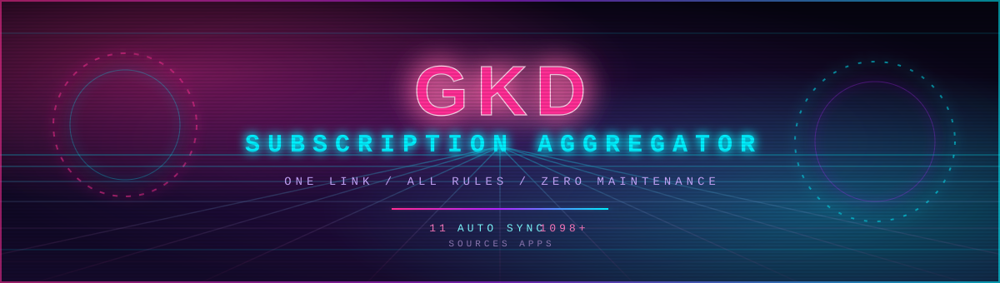

<div align="center">



<p>


</p>


**一个链接，聚合全部 GKD 规则。每天自动同步，零手动维护。**

</div>

## 🔗 订阅入口 / SUBSCRIBE

把下面这个地址导入 GKD 客户端即可：

```
https://raw.githubusercontent.com/gekkxxlloxo/gkd-subscription-aggregator/main/merged.json5
```

产物由 GitHub Actions 每天生成并提交，当前约 **1098 个应用**，实时数量以文件里的 `metadata` 为准。

<div align="center"></div>

## ⚡ 核心能力 / FEATURES

- 🟣 **多源聚合** 11 个上游订阅，按 `appId` 智能去重，同一应用保留最高优先级源的规则
- 🔵 **镜像回退** 主源失败时自动切换 jsDelivr / npmmirror / gitmirror
- 🟢 **常驻自定义规则** 用户提供的 GKD 快照可转成规则，每次同步自动并入，不会被上游覆盖
- 🟡 **定时同步** 每天北京时间 08:00 自动运行，也支持手动触发
- 🔴 **AI 代码质检** 字符与路径检查 + Ruff lint，拦截横杠写成下划线一类的生成错误

<div align="center"></div>

## 📡 订阅源矩阵 / SOURCES

| 源 | 优先级 | 说明 |
|---|:---:|---|
| Lin-arm | 🟣 high | 持续维护中，规则稳定 |
| AIsouler | 🟣 high | 国产应用深度优化 |
| Adpro-Team | 🟣 high | 规则丰富、更新频繁 |
| gkd-kit-official | 🟣 high | GKD 官方订阅 |
| 九千院 | 🔵 medium | 规则量大 |
| GanLin | 🔵 medium | 视频平台优化 |
| MengNianXiaoYao | 🔵 medium | 游戏党专属 |
| DreamXiaoYao (npm) | 🔵 medium | npm 托管，速度快 |
| oklazeno | 🟢 low | 轻量订阅 |
| aoguai | 🟢 low | 含较多自动化规则 |
| AIsouler-Lite | 🟢 low | AIsouler 精简版 |

<div align="center"></div>

## ✨ 定制规则 / CUSTOM RULES

`scripts/custom-rules.json5` 是常驻自定义规则的唯一入口。每次同步按应用 id 和规则组 key 并入产物，key 使用 9000 以上避免与上游冲突。

| key | 应用 | 作用 |
|:---:|---|---|
| 9001 | 酷狗音乐 | 开屏广告跳过按钮 |
| 9002 | 酷狗音乐 | 首页信息流广告关闭按钮 |
| 9003 | YouTube Morphe | 跳过开头赞助片段 |
| 9004 | 钉钉 | 首页横幅广告关闭按钮 |
| 9005 | 酷狗音乐 | 签到弹窗立即签到 |
| 9006 | 酷狗音乐 | 签到成功弹窗关闭按钮 |
| 9007 | 警察叔叔 | 温馨提醒弹窗关闭按钮 |
| 9008 | 微信 | 小程序促销弹窗关闭(FamilyMart) |
| 9009 | 微信 | 小程序促销弹窗关闭(银泰) |

想加规则？发一份 GKD 快照给维护者，规则做好后更新订阅即可生效。

<div align="center"></div>

## 🗂 文件结构 / LAYOUT

| 文件 | 作用 |
|---|---|
| `.github/workflows/sync.yml` | 同步、质检、校验、自动提交 |
| `scripts/sync_and_merge.py` | 核心聚合脚本 |
| `scripts/source-list.json` | 订阅源配置（脚本实际读取） |
| `source-list.json` | 上面那份的镜像，改动需同步 |
| `scripts/custom-rules.json5` | 常驻自定义规则入口 |
| `scripts/char_check.py` | 字符与路径检查 |
| `ruff.toml` | Python lint 配置 |
| `merged.json5` | 自动生成的产物，勿手工编辑 |
| `AGENTS.md` | 给接手 AI 的工作说明书 |

<div align="center"></div>

## 🤖 给 AI 的说明 / FOR AGENTS

如果你是接手维护这个项目的 AI，请先读 [AGENTS.md](AGENTS.md)。里面有文件职责、修改流程、GitHub 操作命令、快照转规则步骤，以及历史上踩过的坑。换模型不用重新摸索。

<div align="center"></div>

## 📊 运行状态 / STATUS

在 [Actions](https://github.com/gekkxxlloxo/gkd-subscription-aggregator/actions) 页面查看每次同步结果。

<div align="center">


<sub>BUILT WITH LIGHT AND LOGIC / GKD SUBSCRIPTION AGGREGATOR</sub>

</div>
